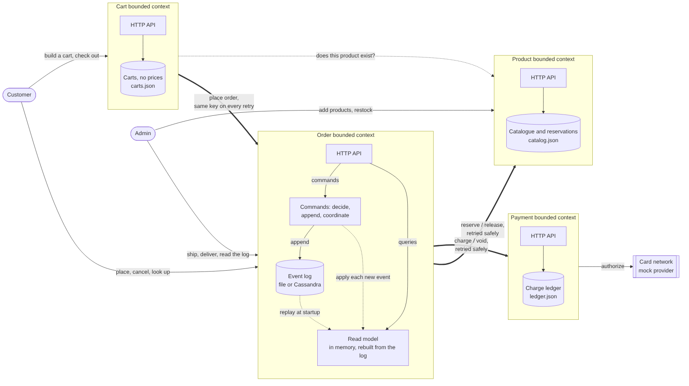

# GoCart

An e-commerce backend as four Go microservices, built to show what happens at the seam between services when the network, a crash, a declined card or a double-click gets involved.

- **Product service** owns the catalogue and the stock that others reserve.
- **Order service** owns orders. It is event sourced: an order is the list of things that happened to it, and its state is whatever replaying them gives. It runs the saga: reserve stock, take payment, and give everything back if the order does not complete.
- **Cart service** owns what a customer intends to buy. Its checkout turns a cart into exactly one order, however many times the button is pressed or the network drops. A cart holds no prices, because the Product service owns those.
- **Payment service** owns charges. There is no real money: a mock card network approves, declines or fails depending on the payment token, so the hard cases can be produced on demand.

The parts worth seeing:

- Stop the Product or the Payment service mid-checkout and the customer still gets an honest answer (`202 Accepted`); the order **completes itself** when the service returns, with stock reserved once and money taken once.
- A declined card is a definite answer (`402`) and the stock goes straight back. A payment provider that *does not answer* is a different thing, and the system does not guess.
- 20 customers each double-click "buy" at the same instant for 3 lamps: exactly 3 are sold, 3 are charged, nobody is charged twice.

```
docker compose up --build        # Product :8080, Order :8081, Payment :8082, Cart :8083
./scripts/smoke.sh               # 71 checks across all four services
./scripts/oversell-demo.sh       # many buyers, little stock
./scripts/outage-demo.sh         # Product down, then Payment down
```

All four services have **no third-party dependencies**: the standard library only. That is a design choice, not an omission: nothing to download, nothing to patch, and a static binary of about 6.5 MB each in an empty `scratch` image, as the Dockerfiles build them.



## Layout

```
gocart-umbrella/
├── product-service/          Go module: catalogue, stock, reservations
├── order-service/            Go module: orders, event log, read model, saga, reconciler
├── payment-service/          Go module: mock card network, charge ledger
├── cart-service/             Go module: carts, retry-safe checkout
├── infra/
│   ├── terraform/            AWS resources as code (plan runs offline, free)
│   └── k8s/                  Kustomize: base, cassandra, overlays {local, staging, staging-cassandra}
├── docs/
│   ├── seed.md  architecture.md  operations.md   (design process, how it works, how to run and change it)
│   ├── openapi/              product.yaml, order.yaml, payment.yaml, cart.yaml
│   └── diagrams/             Mermaid sources, rendered to SVG and PNG
├── scripts/                  smoke, oversell-demo, outage-demo, ship, cleanup, bump-version, check-k8s
├── docker-compose.yml        + docker-compose.cassandra.yml
├── .github/workflows/        ci.yml, release.yml
└── Makefile                  `make help`
```

