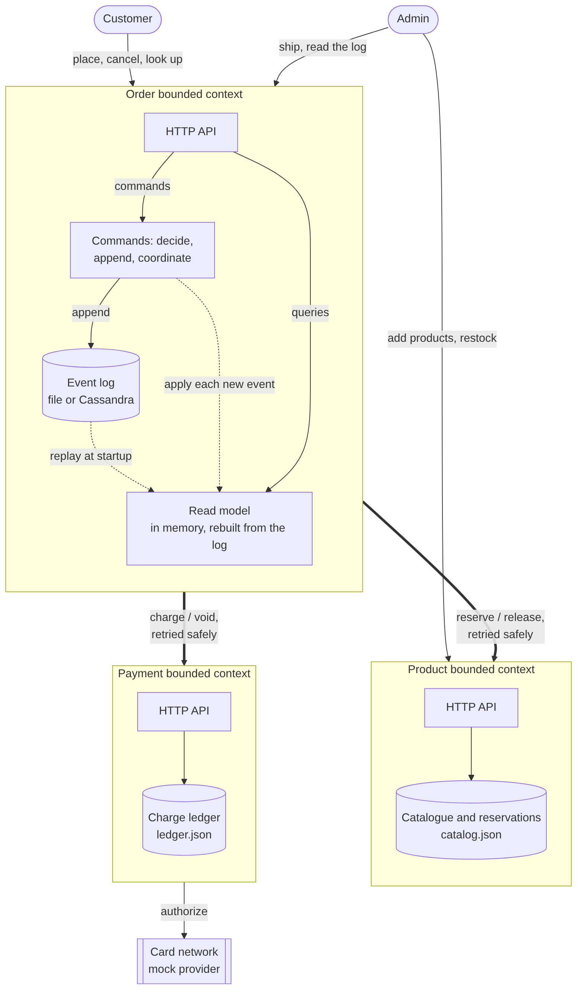
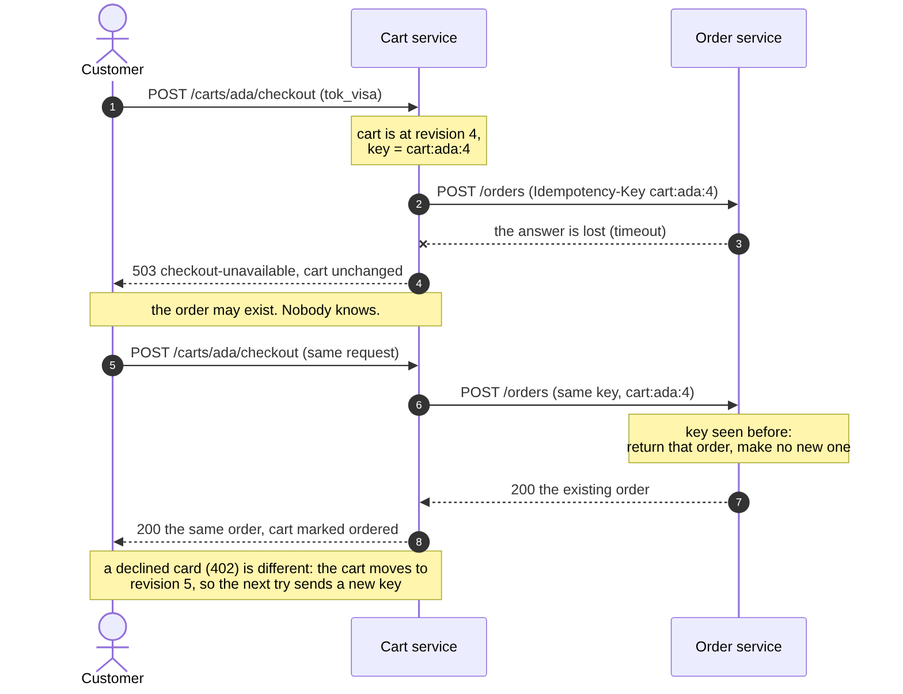

# Architecture



Four services, each in its own bounded context, each owning its own data. The Order service coordinates the purchase: it calls `POST /reservations` and `DELETE /reservations/{order_id}` on the Product service, and `POST /charges` and `DELETE /charges/{order_id}` on the Payment service. The Cart service sits in front: it checks that a product exists (`GET /products/{id}`) and, at checkout, places an order (`POST /orders`). Product and Payment never talk to each other, and neither knows the other exists. Nothing calls the Cart service; it is the outermost edge, so a cart outage cannot hurt an order.

## At a glance

| Layer | What GoCart uses |
|---|---|
| Services | Five Go 1.22 services on the standard library alone: Product, Order, Payment, Cart and the Web gateway. Static binaries of about 6.5 MB in `scratch` images |
| Patterns | Event sourcing and CQRS (Order), a saga with compensations and a reconciler, idempotency keys end to end, optimistic concurrency, a tombstone for late charges |
| Storage | A private store per service: atomic JSON snapshots (Product, Payment, Cart), an append-only event log (Order) that can be a file or Cassandra |
| Contracts | OpenAPI 3.0.3 for every service, RFC 9457 problem documents, route-drift tests, front-end types generated from the specs |
| Identity | OpenID Connect with PKCE (Dex, which fronts Google and GitHub), signed stateless session cookies, a short-lived signed identity the gateway passes to the services, ownership checks where the data lives |
| Front end | React 19, TypeScript, Vite, Tailwind, TanStack Query, React Router, embedded into the gateway binary |
| Packaging | Multi-stage Docker builds, Docker Compose, Kustomize overlays for Kubernetes |
| Edge and network | Traefik with a cert-manager certificate, per-address rate limits, NetworkPolicies that admit only real callers |
| Infrastructure as code | Terraform for ECR repositories, CloudWatch log groups and a least-privilege CI policy |
| Delivery | GitHub Actions (test matrix, Cassandra, front end, infrastructure, end-to-end), a release workflow to `ghcr.io`, one-command version bumps and staging deploys |
| Observability | Structured JSON logs, a request id carried across all five services, Prometheus metrics on every service |

### How a request travels

```
 Browser ──HTTPS──▶ Traefik ──▶ Web gateway ──┬──▶ Product  (catalogue, stock, reservations)
 (React app)   cert-manager     OIDC sign-in  ├──▶ Cart     (what a customer intends to buy)
               rate limits      sessions      ├──▶ Order    (event-sourced orders, saga)
                    │           allow-list    └──▶ Payment  (charges; mock card network)
                    ▼                              Order ──▶ Product, Payment
                   Dex ◀── Google / GitHub         Cart  ──▶ Product, Order
```

The browser never reaches a service directly. NetworkPolicies mean a service accepts traffic only from its real callers, and the Order and Cart services verify who is asking on every customer route.

## What makes these microservices

A service earns the name by being changeable and deployable without asking anyone else. In GoCart that is concrete:

- **Separate modules.** `product-service/`, `order-service/`, `payment-service/` and `cart-service/` have their own `go.mod`, their own Dockerfile and their own tests. None imports another. Each builds and tests from its own directory, and CI runs them as separate matrix jobs.
- **No shared code.** The request-ID, problem-document, metrics and admin-key helpers are a few hundred stable lines and appear in each service. That duplication is deliberate: a shared library would mean a change to it forces every service to release together, which is exactly the coordination cost the architecture exists to avoid. Duplicating a few hundred stable lines is cheaper than that coupling.
- **No shared data.** See [Data](#data).
- **One coordination point, written down.** The Order service's whole understanding of the Product service lives in one file, `order-service/internal/productclient/client.go`, and of the Payment service in another, `internal/paymentclient/client.go`. The contracts they rely on are [`openapi/product.yaml`](openapi/product.yaml) and [`openapi/payment.yaml`](openapi/payment.yaml).

**Reducing coordination costs** is the argument behind all of that. Coordination between teams is the thing that does not scale: every meeting to agree a change, every release train, every "can you deploy before us". The design goal is to shrink what two teams must agree on to a small, explicit, versioned contract.

### Team topology

Using the four team types and three interaction modes from *Team Topologies* (Skelton and Pais):

| Team | Type | Owns | Interacts with |
|---|---|---|---|
| **Checkout** | stream-aligned | Order service, its event log and read model | Catalog via **X-as-a-Service** (the Product API) |
| **Catalog** | stream-aligned | Product service and its data | Checkout via the same API, which it treats as a product with consumers |
| **Payments** | stream-aligned, but in practice close to a *complicated-subsystem* team | Payment service, the provider integration and the ledger | Checkout via X-as-a-Service. Provider integrations are specialist work (money, regulation, fraud), which is the usual reason to give payments its own team |
| **Shopping** | stream-aligned | Cart service: what a customer intends to buy, and the checkout call | Checkout via X-as-a-Service (the Order API), Catalog via the Product API |
| **Platform** | platform | pipeline, Terraform, Kubernetes manifests, the container registry | both, via **X-as-a-Service** (a paved road, not tickets) |

Two additions in practice. For the first few weeks, while the reservation contract is still being found, Checkout and Catalog would use **collaboration** mode, working side by side; once it settles it hardens into X-as-a-Service, and that is the moment to freeze `openapi/product.yaml` behind versioning. And Platform's job is to make the right thing the easy thing: `scripts/ship.sh` and the CI workflows are that, in miniature.

The topology is written down because the *code* is already split along these lines: separate teams could take ownership of these services without changing the architecture first.

## Boundaries

### Domain-driven design

The bounded contexts are not just folders. Each has its own language, and the same real-world thing means something different in each:

| Concept | In the Product context | In the Order context |
|---|---|---|
| Product | A catalogue entry with a live price and a stock level. | Only an ID and a *snapshot*: the name and price quoted when stock was reserved. |
| Customer | Does not exist. | A string ID on an order. There is no customer context yet because nothing needs one. |
| Payment method | Does not exist. | An opaque token the customer supplied. The Order service never learns what is behind it. |
| Order | Does not exist. Only an `order_id` string that keys a reservation. | The central object: everything that happened to it. |
| Cart | Does not exist. | Does not exist. An order is what a cart *became*; the Order service never sees a cart, only the lines and a key. In the Cart context the cart is the central object, and it holds no price. |
| Charge | Does not exist. | Only the *outcome* (a payment reference, or a decline code). |
| Reservation | The central object: stock held for an order. | Never stored. The order records the *outcome* (stock reserved, with these prices). |

The Payment context is a third answer to "what is an order?": to it, an order is only a key under which at most one charge exists. It does not know what was bought.

The snapshot row is the one to dwell on. If the Order service stored a product's current price and looked it up later, a price change would silently rewrite an old order. Instead the Product service returns name and price *at the moment of reservation*, and the order keeps that copy. Two contexts hold "the price", and that duplication is correct: they are answering different questions (what does it cost now / what did this customer agree to pay).


### Sizing the services

Three principles in place of a numeric formula for "how big should a service be":

1. **Start with just a few microservices**, using bounded contexts as the starting boundaries.
2. **Keep splitting** as the system and its teams grow, guided by where coordination is hurting.
3. **Be on the right trajectory** for decreasing coordination. That matters far more than whether today's sizing is perfect.

Applied here: four services is principle 1, one per bounded context, and no smaller. The Cart service earned its place by *changing for different reasons*: carts are edited constantly and thrown away, orders are permanent records, and a bug in one should never be able to damage the other. The case for *not* splitting further is concrete. Stock and reservations live in the Product service together because reserving is one atomic step: check every line, deduct, and record the reservation, or do none of it. Splitting "Inventory" from "Reservations" would turn that into a distributed transaction, which is the problem the design is avoiding.

The likeliest first split, principle 2, would be **Catalog** (names, descriptions, prices: read-heavy, edited by merchandisers) away from **Inventory** (stock and reservations: write-heavy, changes every order). They change at different speeds and for different reasons, so they would eventually want different owners and release rhythms. The trigger is not "it feels big", it is "two teams keep waiting on each other to change this service". Until then, splitting is cost without benefit, and the splitting direction is easier to reverse than merging.

## Data

### Independent deployability and data sharing

There is no database that any two services share, and that is a design rule, not an accident. A shared database would make every schema change a cross-team negotiation, and the services would no longer be independently deployable even though they run in separate containers. **Microservices embed their data**: each service's storage is private to it.

| | Product | Order | Payment |
|---|---|---|---|
| Stores | the *current state* of the catalogue and reservations | the *history* of every order | the *current state* of each order's charge |
| How | one JSON snapshot, replaced atomically on every change (write temp file, fsync, rename) | an append-only event log, fsynced on every append | the same atomic snapshot technique, one entry per order id |
| Why that shape | a catalogue is state: nobody asks what the lamp's price was on a given Tuesday | an order is a story: what happened, in what order, matters | a ledger entry is looked up by key and answered the same way every time; the Order service already holds the story |
| Recovery | crash-safe by construction: a reader sees the old file or the new, never half | a torn final write is detected and cut off at startup; corruption anywhere else refuses to start | as Product, and a corrupt ledger refuses to start rather than quietly forgetting what was charged |

Choosing different storage for each service is the point: each picks what suits it. Cassandra suits the Order service's event log (append-heavy, partitioned by order), and the Order service can use it as its store. See [operations.md](operations.md#cassandra).

### Event sourcing and CQRS

**Event sourcing.** An order is never stored as a row that gets updated. It is stored as the list of events that happened to it, and its state is whatever you get by replaying them. `GET /orders/{id}/events` shows that list for any order:

```
v1  OrderPlaced
v2  StockReserved
v3  PaymentCaptured
v4  OrderCancelled
v5  StockReleased
v6  PaymentRefunded
```

What this buys, and where in the code:

- **Decisions are pure.** `internal/domain/order.go` holds the whole state machine as functions from state to events. It is tested as a table (`TestTransitionMatrix`: every command in every state) with no database, network or clock.
- **Concurrency without locks.** Every event carries its position in the order's stream (`version`). Appending version *n* succeeds only if the stream currently has *n-1* events; otherwise the store says `ErrVersionConflict` and the command reloads and decides again. Twelve simultaneous cancels of one order produce exactly one cancellation and eleven refusals (`TestConcurrentCancelsOnlyOneWins`).
- **Damaged history is detected, not guessed at.** Replay refuses gaps, duplicates, unknown event types and impossible transitions. Skipping a bad event would silently change what an order *is*.
- **The read model is disposable.** `TestRestartRebuildsEveryOrderFromTheLog` throws it away, restarts on the same log, and checks every order comes back exactly as it was.

**CQRS** (Command Query Responsibility Segregation) means the model that *decides* and the model that *answers* are different things:

- **Command side:** `POST /orders`, `.../cancel`, `.../ship`, `.../deliver`. These load the order's events, replay them, decide, and append. They never read the projection.
- **Query side:** `GET /orders`, `GET /orders/{id}`. These read `internal/projection`, a flat in-memory view with a by-customer index, shaped for the API instead of for decisions. They never replay events.

*Scope of the separation:* the two sides share a process, and the view is updated right after each append, under a lock. That is CQRS with separate models, not with separate infrastructure. What does hold is the separation that matters: commands decide from the log, queries read the view, and the view can be rebuilt at any time.

**Running more than one Order replica** (Cassandra store). Each replica has its own view, so each must learn about orders the others handled. Appending an event also writes the order's id to a small `order_changes` table (bucketed by hour, ordered by timeuuid, expiring after a day). Every `SYNC_INTERVAL` (2s) a replica reads the ids changed since its last look, minus a 10s overlap, and replays just those streams into its view. Applying an event is idempotent per version, so overlap and duplicates are harmless. The feed is only a *hint*: every `RESYNC_INTERVAL` (5m) a replica reloads the whole log, so a lost feed row delays a view by minutes instead of leaving it wrong forever. Commands first catch up on the order they touch, and `GET /orders/{id}` falls back to the log when the view has not seen the order, so those two are never stale. A list (`GET /orders`) can trail another replica by up to `SYNC_INTERVAL`. That is the eventual consistency CQRS signs up for, stated rather than hidden. Both replicas run the reconciler; that is safe because every step it takes (reserve, charge, release, void) is idempotent per order. Covered by `internal/service/sync_test.go`, including a lost feed, a failed sync and concurrent load across replicas.

### Event sourcing and CQRS beyond microservices

Neither idea needs microservices. A bank account is an event-sourced thing: the balance is derived from the ledger of transactions, never the other way round, and the statement is a read model. Version control is the same shape: a commit history is the log, a checkout is a projection. Event sourcing earns its keep wherever *how you got here* matters (audit, undo, dispute, debugging), and CQRS wherever reads and writes want different shapes. It is wasted on a plain CRUD table, which is why the Product service does not use it.

## Orders are a saga

The services cannot share a transaction, so placing an order is a sequence of steps with a crash possible between any two:

1. store `OrderPlaced`: the order exists, durably;
2. ask the Product service to reserve stock; store `StockReserved` (or `OrderRejected` if Product said no). The order is now `awaiting_payment` and its total is known;
3. ask the Payment service to charge that total; store `PaymentCaptured` (or `PaymentDeclined`). The order is now `confirmed` (or `payment_failed`).

The order of steps 2 and 3 is deliberate. Stock is reserved first because a stock shortage is cheap to undo (nothing to give back) and a payment is not; and the price is needed to know what to charge.

If anything stops in between (a timeout, an outage, a crash), the order is left in `placed` or `awaiting_payment`. Those are real, queryable states, not corrupt ones. **The reconciler** (`Service.Reconcile`) finds orders that have been waiting longer than a grace period and finishes them. Because every step it repeats is idempotent per order ID (the Product service returns the existing reservation, the Payment service returns the existing charge), finishing is always safe.

### Compensations: giving things back

Several ways for an order to end leave something owed to another service. The order records each debt as state until it has been paid, so the reconciler always knows what is still outstanding:

| Order ends as | Why | Stock owed back | Money owed back |
|---|---|---|---|
| `payment_failed` | the card was declined | yes | no (nothing was charged) |
| `expired` | nobody paid within `PAYMENT_TTL` (default 15 minutes) | yes | yes: a void, in case a charge is in flight |
| `cancelled` | the customer cancelled a confirmed order | yes | yes: a refund |
| `rejected` | Product refused (no stock) | no (nothing was held) | no |

The two debts are independent. If the Payment service is down when an order is cancelled, the stock still goes back immediately and the refund is retried until it lands (`TestCancelWithPaymentDownStillReturnsTheStock`); with both services down, both debts are owed and both are paid when they return (`TestCancelWithBothServicesDownOwesBothAndPaysBothLater`). `stock_release_pending` and `refund_pending` on the order say which is still outstanding.

This is demonstrated, not just described. `scripts/outage-demo.sh` runs two acts: the Product service goes down mid-order, then the Payment service does. Each time the customer gets `202`, the order finishes by itself when the service returns, and stock and money each move exactly once. With the reconciler polling every second, the event timestamps show `StockReserved` recorded 10.8 seconds after `OrderPlaced` (Act 1) and `PaymentCaptured` 10.9 seconds after `StockReserved` (Act 2): the 10-second grace period plus a fraction of a tick. At the default 5-second interval, recovery takes up to about 15 seconds.

Retries are safe on every side of every call:

- **Customer to Order:** the `Idempotency-Key` header. The same key and request returns the same order (`200`), a different request under the same key (including a different `payment_token`) is `422`. The key is scoped to the customer, so two customers using the same key do not collide.
- **Order to Product:** reservation and release are idempotent per order ID. The client retries only when it *cannot know* whether a request landed (network error, 5xx, 429), never on a definite answer such as "insufficient stock".
- **Order to Payment:** a charge is identified by its order ID, so asking twice returns the recorded answer. Same retry rule.

## Payments

The Payment service exists for one reason: to be the place where "the money" is a hard problem, and to show what that does to the services around it. There is no real money. Charges go to a mock card network (`payment-service/internal/gateway`) whose behaviour is chosen by the `payment_token`, the way real providers' test cards work, so declines and outages can be produced on demand.

### Three answers, not two

A charge can come back approved, declined, or not at all, and the difference between the last two is the whole difficulty:

| Answer | Meaning | What the Order service does |
|---|---|---|
| approved (`201`/`200`) | the money was taken | records `PaymentCaptured`, order confirmed |
| declined (`402`) | the card network said no; definite | records `PaymentDeclined`, releases the stock, tells the customer (`402`) |
| no answer (`503`, timeout, connection lost) | **unknown**: the money may or may not have been taken | decides nothing; the order stays `awaiting_payment` and the charge is asked for again |

Treating "no answer" as a decline would cancel orders that were paid for. Treating it as an approval would ship goods nobody paid for. `TestLostResponseIsNotADeclineAndIsNeverChargedTwice` covers the dangerous case: the charge succeeds, the response is lost, and the retry must find the existing charge, not make a second one. The provider's side of this is `tok_slow`, which approves *after* the caller's timeout, which is how real charges succeed while the caller never hears about it.

### One charge per order

The Payment service keys everything on the order ID, and serialises work per order while the provider is being called. So 20 simultaneous requests to charge one order produce one provider call and one reference (`TestConcurrentDuplicateChargesProduceOneCharge`), and a slow charge for one order does not hold up another's. A repeat with a different amount is refused (`charge-mismatch`) rather than treated as a new charge. A decline is also recorded and replayed: a customer with a different card places a different order.

### The tombstone

Cancelling needs care at one moment: an order is abandoned while its charge request is still in flight. If the void arrived first and found nothing to void, a later-arriving charge would succeed on an order that is already over. So voiding an order with no charge records a *tombstone*, and any charge for that order afterwards is refused (`charge-voided`, `409`). If the void arrives while a charge is mid-call, it waits for that call to finish and then refunds it. Expiry uses the same mechanism, which is why `expired` owes a void even though the order never confirmed (`TestOrderExpiringDuringAChargeEndsUpRefunded`).

### What is never stored

A payment token is an opaque reference to a payment method, never a card number. The Order service refuses anything that is not shaped like `tok_` plus lowercase letters, digits and underscores, *before* writing the event, because an append-only log is the worst possible place for a card number: it can never be edited out. The Payment service applies the same rule independently. The token is kept in `OrderPlaced` so a payment that could not complete can be retried without asking the customer again; it is never returned by the API, and `GET /orders/{id}/events` strips it from the payload.

## Carts and checkout

The Cart service is small on purpose. Its whole job is to remember what a customer intends to buy and to turn that into one order exactly once. 

- **A cart holds no price.** A copy would go stale, then disagree with what the Order service charges. The cart shows names; the order carries the prices quoted by the Product service when stock is reserved.
- **Adding a product checks that it exists** (one `GET` to the Product service), and only the first time: changing a quantity needs no lookup, so it works through a Product outage. An outage is reported as `503`, never as "unknown product", which would be a lie.
- **Checkout is retry-safe by construction.** Every cart has a *revision* that moves on each real change. Checkout sends `Idempotency-Key: cart:<customer>:<revision>`, so the same cart in the same state is always the same key, and the Order service has the final say on duplicates. That gives three cases, each tested: no answer leaves the cart untouched and the retry finds the order if one was made; an answer that is lost on its way back leaves the cart marked with its `order_id`, so a repeat replays the same order (`200`); a definite refusal (declined card, out of stock) moves the cart to a *new* revision, because the old key would replay the refusal forever.
- **A checked-out cart is frozen, not emptied.** It keeps its lines so a repeated checkout can be answered. The next change to it starts a fresh cart.
- **An edit made while checkout is in flight is never lost**, and is never mislabelled as part of the order: marking a cart as ordered only happens if its revision is still the one that was sent.
- **Checkout passes the Order service's answer through**, status and body, so `402`, `409` and `202` reach the customer exactly as the Order service said them. The Cart service does not restate that contract; its spec points at the Order spec.

## The web gateway and the storefront

The browser talks to one origin, the Web service, and never to the four services directly.

- **An allow-list, not a pass-through.** The gateway forwards exactly the routes a shopper or an admin needs (catalogue, carts, orders and their events, charge look-ups, health) and answers `404` to everything else. The endpoints that exist for services to call each other, stock reservations and creating or voiding charges, are not reachable from a browser at all. A test compares the forwarded routes with the OpenAPI files, so a route cannot be forwarded without being specified.
- **It adds no business logic.** Status codes and problem bodies pass through unchanged, so `402`, `409` and `202` mean to the page what they mean to a script. When a service cannot be reached the gateway answers `502` with the same problem format and says which one.
- **One app, one file.** The compiled React app is embedded in the Go binary (`go:embed`), so the image is a single static file in `scratch`. Unknown paths fall back to `index.html` so deep links work; unknown `/api/` paths are `404` problems, never HTML.
- **The front end is typed from the contract.** Its API types are generated from `docs/openapi/*.yaml` and CI fails if the generated files are stale.
- **The UI keeps the same promises as the API.** Checkout shows "we could not confirm" for no answer and "declined" for a definite no, and the retry button after the first is safe because the Cart service derives its idempotency key from the cart. While an order is settling the page polls; the order page reads like a receipt, the admin order page shows the event log it was built from.
- **There is a sign-in, and it is the gateway's job** (next section). Browsing the catalogue is public; carts, orders and the admin console need a signed-in person.

## Who is asking: sign-in and ownership

Three questions are kept apart: *who is this* (an identity provider answers), *may they do this* (each service answers, about its own data), and *who may reach this service at all* (the network answers).

- **Sign-in is OpenID Connect, done by the gateway.** The browser is sent to the identity provider (Dex, which can also front Google and GitHub; any OIDC provider in principle, since GoCart only knows an issuer, a client id and a secret). It comes back with a one-time code, which the gateway swaps for an ID token and checks properly: RS256 only, signed by a key from the provider's published key set (refetched when a key rotates, at most every ten seconds), and the right issuer, audience, expiry and *nonce*. The authorization-code flow uses PKCE and a `state` check, so a response meant for someone else's login is refused.
- **The session is a signed cookie, not a row in a table.** It holds the customer id, name, email and an expiry, is `HttpOnly`, `SameSite=Lax` and `Secure` over HTTPS, and is signed with a secret under a purpose label so a login-handshake cookie cannot be replayed as a session. Because nothing is stored, any gateway replica can serve any request. Sessions last 8 hours, and the identity assertion sent on to the services lives only 30 seconds. Changing requests also need an `X-Requested-With` header a cross-site form cannot send.
- **The customer id is derived, not typed**: a hash of the provider's issuer and the person's subject (`cust_` and 16 hex digits). People cannot choose it and two providers cannot collide.
- **The gateway vouches for the person to the Order and Cart services.** It removes whatever `Cookie`, `Authorization` and identity header the browser sent, then adds a signed assertion (`X-Gocart-Identity`: the customer id, a role and a 30-second expiry, signed with a secret the gateway and the two services share). For an administrator (an email on the `ADMIN_EMAILS` list *with a verified address*) it also adds the shop's admin key, which only the gateway holds, so the browser never sees it.
- **Each service enforces ownership of its own data.** A customer can place an order only in their own name (`403`), list only their own, and asks for someone else's order and gets `404`, as though it did not exist, so ids cannot be probed. A cart is the same, `403`. This is checked where the data lives, not only at the gateway, so a mistake in the gateway's allow-list cannot expose another person's order.
- **Fail closed.** With `REQUIRE_IDENTITY=true` (compose and Kubernetes) a customer route with no assertion is `401`. Without it, a request with no assertion counts as trusted local use so a service can still be run by hand, but a *bad* assertion is always refused, and a service started with the flag but no secret refuses to start.
- **The network is the second lock.** In Kubernetes, NetworkPolicies let only the ingress controller reach the gateway and Dex, and only the named callers reach each service, so no pod can call the Order service directly. `check-k8s.py` fails if a service calls another that its policy does not admit.
- **The edge.** Traefik terminates HTTPS with a certificate cert-manager issues, and rate-limits per client address (`429`), with a tighter limit on `/auth/`. It is the `local-https` overlay. Locally the certificate is self-signed; for a real hostname, `infra/k8s/cert-manager/letsencrypt.example.yaml` has the Let's Encrypt issuers.

## Future scope

| Area | Next step |
|---|---|
| **Scale-out** | Product, Payment and Cart move to a shared database so each can run several replicas (Order already runs two on Cassandra) |
| **Data operations** | A managed database or Cassandra operator, scheduled backups, and a rehearsed restore |
| **Payments** | A real provider such as Razorpay in test mode: webhooks for late outcomes, saved payment-method ids, reconciliation against the provider's records |
| **Messaging** | A broker (NATS or Kafka) and a transactional outbox in place of the polling reconciler and change feed, plus a notifications service |
| **Identity** | A server-side session table for instant sign-out, per-person admin roles verified by the services, mutual TLS between services |
| **Secrets** | An external secrets manager with rotation, in place of Kubernetes Secrets |
| **Observability** | Prometheus and Grafana dashboards with alerts, central logs, and OpenTelemetry traces built on the existing request id |
| **Resilience** | Autoscaling, pod disruption budgets, and resource limits tuned from load tests |
| **Delivery** | Image scanning and signing, and GitOps with Argo CD or Flux in place of `ship.sh`; applying the Terraform to a cloud account |
| **Catalogue and carts** | A database for the catalogue as it grows; short-lived stock reservation when an item is added to a cart |
