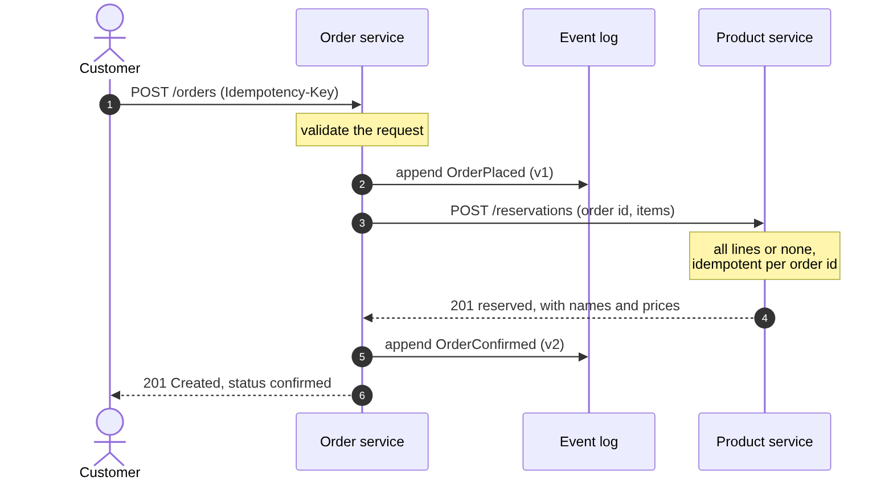
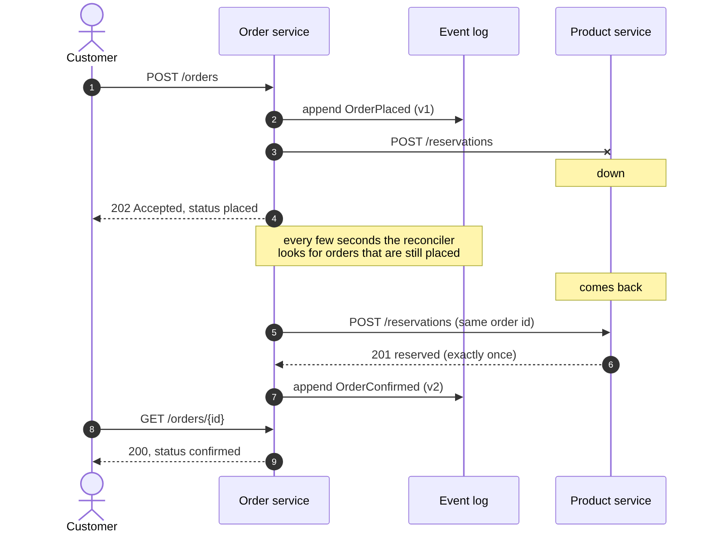
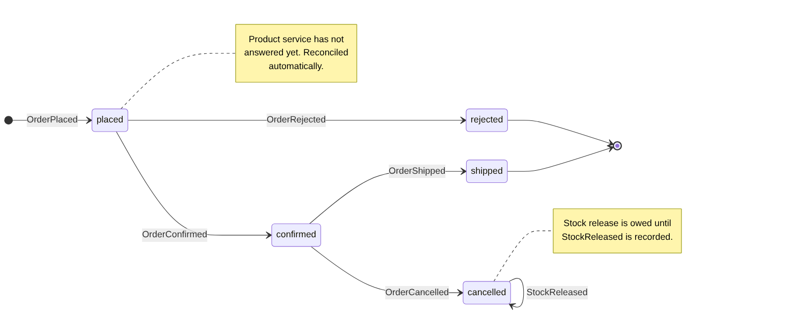

# Designing GoCart with the SEED(S) process

SEED(S), the Seven Essential Evolutions of Design for Services, is a way of getting from "we want an e-commerce backend" to service APIs without starting from a database schema. Each step produces something you can look at. This page walks through all seven for GoCart and points at the artifact each one left behind.

| # | Step | Artifact in this repository |
|---|------|------------------------------|
| 1 | Identify actors | [Actors](#1-actors) below |
| 2 | Identify the jobs actors have to do | [Jobs to be done](#2-jobs-to-be-done) below |
| 3 | Discover interaction patterns with sequence diagrams | [place-order](diagrams/place-order.png), [outage](diagrams/outage.png) |
| 4 | Derive actions and queries from the jobs | [Table](#4-actions-and-queries) below |
| 5 | Describe each as a specification in an open standard | [`openapi/product.yaml`](openapi/product.yaml), [`openapi/order.yaml`](openapi/order.yaml) |
| 6 | Get feedback on the API specification | [Below](#6-getting-feedback-on-the-specification) (read the caveat) |
| 7 | Implement the microservices | `product-service/`, `order-service/` |

## 1. Actors

| Actor | Who they are | Talks to |
|---|---|---|
| **Customer** | Someone buying things. | Order service |
| **Admin** | Someone running the shop: curates the catalogue, restocks, ships orders. | Product service (catalogue), Order service (shipping) |
| **Order service** | Acts as a client of the Product service when it needs stock held. | Product service |

The third row is the useful one. A service that calls another is an actor in the other's design, which is why the Product service has endpoints (`/reservations`) that no human ever calls. Finding those is the point of doing the actors step before the API step.

## 2. Jobs to be done

Each job is written as "When ..., I want to ..., so I can ...". They are about outcomes, not endpoints.

**Customer**
- J1. When I have picked what I want, I want to place an order, so I can get it. *And I want to know straight away whether it worked.*
- J2. When my connection drops mid-checkout, I want to retry without being charged twice, so I can trust the checkout.
- J3. When I wonder what happened to an order, I want to look it up, so I know where it stands.
- J4. When I change my mind, I want to cancel, so I get my reservation released.

**Admin**
- J5. When we stock a new item, I want to add it to the catalogue, so customers can buy it.
- J6. When a delivery arrives, I want to set the stock level, so the shop does not sell what it has not got.
- J7. When an order leaves the warehouse, I want to mark it shipped, so the customer's view is true.

**Order service (as a client)**
- J8. When an order is placed, I want stock held for it, all lines or none, so I never promise what is not there.
- J9. When an order is cancelled, I want the stock given back, so it can be sold again.

## 3. Interaction patterns

Two sequence diagrams, because they show different things.

**The happy path** ([source](diagrams/place-order.mmd)): the Order service records that the order exists *before* it asks the Product service about stock. That one decision is what makes the second diagram possible.



**When the Product service is down** ([source](diagrams/outage.mmd)): this is the diagram that changed the design. Drawing J1 honestly raises the question "what does the customer see if the Product service does not answer?", and there are only three answers: lose the order, fail the request, or accept it and finish later. GoCart accepts it (`202`), says so truthfully (`status: placed`), and finishes it automatically. See [architecture.md](architecture.md#orders-are-a-small-saga).



The order's life as a state machine ([source](diagrams/order-lifecycle.mmd)):



## 4. Actions and queries

An **action** changes state; a **query** only reads it. Splitting them this way is what the CQRS design in the Order service follows.

| Job | Kind | Operation | Service |
|---|---|---|---|
| J1, J2 | action | `POST /orders` (with `Idempotency-Key`) | Order |
| J3 | query | `GET /orders/{id}`, `GET /orders`, `GET /orders/{id}/events` | Order |
| J4 | action | `POST /orders/{id}/cancel` | Order |
| J7 | action | `POST /orders/{id}/ship` | Order |
| J5 | action | `POST /products` | Product |
| J6 | action | `PUT /products/{id}/stock` | Product |
| J3 (browse) | query | `GET /products`, `GET /products/{id}` | Product |
| J8 | action | `POST /reservations` | Product |
| J9 | action | `DELETE /reservations/{order_id}` | Product |

Two details worth noticing. J2 turned into a header on an existing action rather than a new endpoint: retries are a property of how an action is called, not a separate job. And J9 is `DELETE` because releasing is naturally repeatable: releasing something already released is a success, which is what lets the Order service retry it safely.

## 5. Specifications in an open standard

Both APIs are described in **OpenAPI 3.0.3**, the open standard:

- [`openapi/product.yaml`](openapi/product.yaml)
- [`openapi/order.yaml`](openapi/order.yaml)

Each documents every endpoint, request body, response, and error (as RFC 9457 problem documents). Money is integer paise throughout. The status codes carry meaning rather than just success/failure: for example `POST /orders` has three different non-error outcomes (`201`, `200` for an idempotent replay, `202` for accepted-but-undecided).

**Specifications are enforced, not just written.** A test in each service parses its OpenAPI file and fails the build if the router has an endpoint the spec does not, or the spec has one the router does not. I checked that this test really fails by renaming a path in the spec and watching it go red.

*What that test does not check:* it compares paths and methods, not request or response schemas. A field renamed in code but not in the spec would pass. Schema-level checking needs an OpenAPI validator library, which would be the project's first third-party dependency, and I judged that not worth it here.

*On order of writing:* the files do not prove which came first, and I will not claim the specs were written strictly before the handlers. What can be claimed is that the spec is authoritative in CI: code that disagrees with it does not merge.

To browse a spec interactively, with no install, using Swagger UI in a container:

```
docker run --rm -p 8082:8080 -e SWAGGER_JSON=/spec/order.yaml \
  -v "$PWD/docs/openapi:/spec" swaggerapi/swagger-ui
```

then open <http://localhost:8082>.

## 6. Getting feedback on the specification

SEED treats the spec as something to put in front of its consumers *before* building. For GoCart the consumers would be the front-end developers (who call the Order service) and the warehouse tool (which calls the Product service).

**Caveat: no one outside this project has reviewed these specs.** I have not collected feedback and will not invent any. What exists is the mechanism: the Swagger UI command above lets a reviewer try the API from the spec alone, and these are the questions worth asking them:

1. Can you place an order, and understand every possible outcome, from `order.yaml` alone?
2. Is `202 Accepted` with `status: placed` clear enough that your client will poll instead of treating it as a failure?
3. Does anything in the error documents force you to parse prose to decide what to do next?

If you are submitting this as coursework, ask a classmate to attempt step 1 and add a short paragraph here about what they found and what you changed. That paragraph is the step-6 evidence, and only you can write it truthfully.

## 7. Implementation

Each service is a separate Go module with no third-party dependencies, built and tested on its own. See the [README](../README.md) for how to run them, and [architecture.md](architecture.md) for why they are shaped the way they are.

### Microservices versus APIs

The syllabus separates these, and GoCart shows the difference. An **API** is a contract: the OpenAPI files above. A **microservice** is a unit that is deployed on its own and owns its own data, behind such a contract. The Product service's API could be wrapped around a shared database and it would still be an API, but not an independently deployable microservice, because changing the table would change every service reading it. Here, nothing outside a service can reach its data, so the API is the only way in, and the API is therefore the only thing that has to stay stable.
