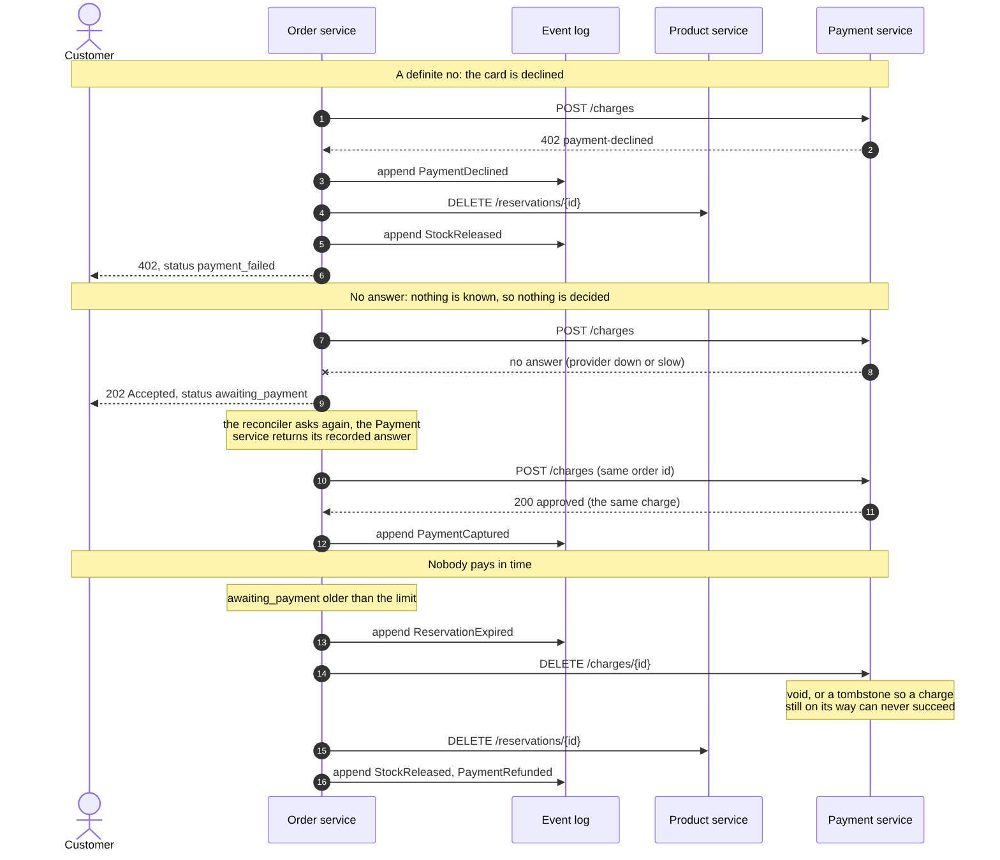
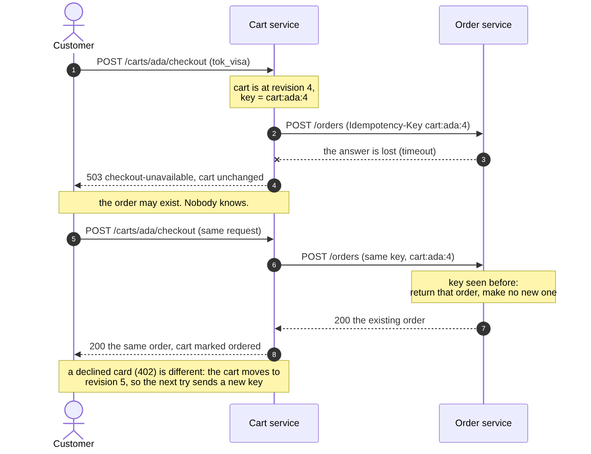

# Designing GoCart with the SEED(S) process

SEED(S), the Seven Essential Evolutions of Design for Services, is a way of getting from "we want an e-commerce backend" to service APIs without starting from a database schema. Each step produces something you can look at. This page walks through all seven for GoCart and points at the artifact each one left behind.

| # | Step | Artifact in this repository |
|---|------|------------------------------|
| 1 | Identify actors | [Actors](#1-actors) below |
| 2 | Identify the jobs actors have to do | [Jobs to be done](#2-jobs-to-be-done) below |
| 3 | Discover interaction patterns with sequence diagrams | [place-order](diagrams/place-order.png), [outage](diagrams/outage.png), [payment-failure](diagrams/payment-failure.png) |
| 4 | Derive actions and queries from the jobs | [Table](#4-actions-and-queries) below |
| 5 | Describe each as a specification in an open standard | [`openapi/product.yaml`](openapi/product.yaml), [`openapi/order.yaml`](openapi/order.yaml), [`openapi/payment.yaml`](openapi/payment.yaml) |
| 6 | Get feedback on the API specification | [Below](#6-getting-feedback-on-the-specification) (read the caveat) |
| 7 | Implement the microservices | `product-service/`, `order-service/`, `payment-service/` |

## 1. Actors

| Actor | Who they are | Talks to |
|---|---|---|
| **Customer** | Someone buying things. | Order service |
| **Admin** | Someone running the shop: curates the catalogue, restocks, ships orders, investigates. | Product service (catalogue), Order service (shipping, the event log), Payment service (look up a charge) |
| **Order service** | Acts as a client of the Product and Payment services when it needs stock held or money taken. | Product service, Payment service |

The third row is the useful one. A service that calls another is an actor in the other's design, which is why the Product service has endpoints (`/reservations`) and the Payment service has endpoints (`/charges`) that no human ever calls. Finding those is the point of doing the actors step before the API step.

Adding payments in version 0.2 is a good test of the process: the new actor was a *service* (the Payment service), and finding it meant going back to J1 ("place an order, and know straight away whether it worked") and asking what "worked" now includes.

## 2. Jobs to be done

Each job is written as "When ..., I want to ..., so I can ...". They are about outcomes, not endpoints.

**Customer**
- J1. When I have picked what I want, I want to place an order, so I can get it. *And I want to know straight away whether it worked.*
- J2. When my connection drops mid-checkout, I want to retry without being charged twice, so I can trust the checkout.
- J3. When I wonder what happened to an order, I want to look it up, so I know where it stands.
- J4. When I change my mind, I want to cancel, so I get my reservation released *and my money back*.
- J10. When I pay, I want a declined card to be a clear, final answer, so I am not left wondering whether I was charged.

**Admin**
- J5. When we stock a new item, I want to add it to the catalogue, so customers can buy it.
- J6. When a delivery arrives, I want to set the stock level, so the shop does not sell what it has not got.
- J7. When an order leaves the warehouse, I want to mark it shipped, so the customer's view is true.
- J14. When an order reaches the customer, I want to mark it delivered, so the order is closed and can no longer be cancelled.
- J11. When something looks wrong with an order, I want to read its full history and its charge, so I can say what happened.

**Shopper**
- J15. When I am deciding, I want to put products in a cart and change my mind, so I can buy them together.
- J16. When I check out, I want one order even if I click twice or the network drops, so I am never charged twice.

**Order service (as a client)**
- J8. When an order is placed, I want stock held for it, all lines or none, so I never promise what is not there.
- J9. When an order is cancelled, I want the stock given back, so it can be sold again.
- J12. When stock is held, I want the customer charged exactly once, so a retry never costs them twice.
- J13. When an order ends without being paid for (declined, abandoned, cancelled), I want the stock and any money given back, so nothing stays locked up or taken.

## 3. Interaction patterns

Four sequence diagrams, because they show different things.

**The happy path** ([source](diagrams/place-order.mmd)): the Order service records that the order exists *before* it asks the Product service about stock, and records that stock is held *before* it asks the Payment service for money. Each of those decisions is what makes the next diagram possible.


**When the Product service is down** ([source](diagrams/outage.mmd)): this is the diagram that changed the design. Drawing J1 honestly raises the question "what does the customer see if the Product service does not answer?", and there are only three answers: lose the order, fail the request, or accept it and finish later. GoCart accepts it (`202`), says so truthfully (`status: placed`), and finishes it automatically. See [architecture.md](architecture.md#orders-are-a-saga).


**When payment goes wrong** ([source](diagrams/payment-failure.mmd)): drawing J10 and J12 forced a distinction the first version of the design did not have. "The charge did not go through" means three different things: the card was *declined* (a definite no: give the stock back and tell the customer), the provider *did not answer* (nothing is known: the money may even have been taken, so do not decide anything, ask again), or *nobody paid in time* (give up, give everything back, and make sure a charge still in flight cannot land afterwards). Getting the first two confused would either cancel orders that were paid for or ship goods nobody paid for.



**When checkout does not get an answer** ([source](diagrams/checkout.mmd)): drawing J16 asked a question the other diagrams skipped: the Cart service calls the Order service, the answer is lost, and the customer clicks again. Did that make two orders? It would have, if the second call looked new. So the cart's state became part of the request: the Idempotency-Key is built from the cart's revision, and a *definite* refusal (as opposed to no answer) is the one thing that changes it. That is the second time the "no answer is not a no" distinction has shaped the design, and it is the same distinction as in the payment diagram, one layer further out.



The order's life as a state machine ([source](diagrams/order-lifecycle.mmd)):


## 4. Actions and queries

An **action** changes state; a **query** only reads it. Splitting them this way is what the CQRS design in the Order service follows.

| Job | Kind | Operation | Service |
|---|---|---|---|
| J1, J2, J10 | action | `POST /orders` (with `Idempotency-Key` and `payment_token`) | Order |
| J3 | query | `GET /orders/{id}`, `GET /orders` | Order |
| J11 | query | `GET /orders/{id}/events` (admin) | Order |
| J4, J13 | action | `POST /orders/{id}/cancel` (refunds and releases stock) | Order |
| J7 | action | `POST /orders/{id}/ship` | Order |
| J14 | action | `POST /orders/{id}/deliver` (shipped orders only; final) | Order |
| J15 | action | `PUT /carts/{customer_id}/items/{product_id}`, `DELETE` of an item or of the cart | Cart |
| J15 | query | `GET /carts/{customer_id}` | Cart |
| J16 | action | `POST /carts/{customer_id}/checkout` (retry-safe; calls `POST /orders`) | Cart |
| J5 | action | `POST /products` | Product |
| J6 | action | `PUT /products/{id}/stock` | Product |
| J3 (browse) | query | `GET /products`, `GET /products/{id}` | Product |
| J8 | action | `POST /reservations` | Product |
| J9 | action | `DELETE /reservations/{order_id}` | Product |
| J12 | action | `POST /charges` (idempotent per order) | Payment |
| J13 | action | `DELETE /charges/{order_id}` (void or refund) | Payment |
| J11 | query | `GET /charges/{order_id}` (admin) | Payment |

Two details worth noticing. J2 turned into a header on an existing action rather than a new endpoint: retries are a property of how an action is called, not a separate job. J9 and J13 are `DELETE` because releasing and voiding are naturally repeatable: doing either twice is a success, which is what lets the Order service retry them safely. J13 has one extra property worth the thought it took: voiding a charge that does not exist *yet* records a tombstone, so a charge request that was already on its way when the order was abandoned can never succeed afterwards.

## 5. Specifications in an open standard

All four APIs are described in **OpenAPI 3.0.3**, the open standard:

- [`openapi/product.yaml`](openapi/product.yaml)
- [`openapi/order.yaml`](openapi/order.yaml)
- [`openapi/payment.yaml`](openapi/payment.yaml)
- [`openapi/cart.yaml`](openapi/cart.yaml)

Each documents every endpoint, request body, response, and error (as RFC 9457 problem documents). Money is integer paise throughout. The status codes carry meaning rather than just success/failure: for example `POST /orders` has several different outcomes: `201` confirmed, `200` an idempotent replay, `202` accepted-but-undecided, and for the two failures `409` (stock refused) and `402` (card declined), which the caller must treat differently from each other.

**Specifications are enforced, not just written.** A test in each service parses its OpenAPI file and fails the build if the router has an endpoint the spec does not, or the spec has one the router does not. I checked that this test really fails by renaming a path in the spec and watching it go red.

*What that test does not check:* it compares paths and methods, not request or response schemas. A field renamed in code but not in the spec would pass. Schema-level checking needs an OpenAPI validator library, which would be the project's first third-party dependency, and I judged that not worth it here.

*On order of writing:* the files do not prove which came first, and I will not claim the specs were written strictly before the handlers. What can be claimed is that the spec is authoritative in CI: code that disagrees with it does not merge.

To browse a spec interactively, with no install, using Swagger UI in a container:

```
docker run --rm -p 8090:8080 -e SWAGGER_JSON=/spec/order.yaml \
  -v "$PWD/docs/openapi:/spec" swaggerapi/swagger-ui
```

then open <http://localhost:8090>. (Port 8082 is the Payment service.)

## 6. Getting feedback on the specification

SEED treats the spec as something to put in front of its consumers *before* building. For GoCart the consumers would be the front-end developers (who call the Order service) the warehouse tool (which calls the Product service), and whoever integrates a payment provider (which the Payment service stands in for).

**Caveat: no one outside this project has reviewed these specs.** I have not collected feedback and will not invent any. What exists is the mechanism: the Swagger UI command above lets a reviewer try the API from the spec alone, and these are the questions worth asking them:

1. Can you place an order, and understand every possible outcome, from `order.yaml` alone?
2. Is `202 Accepted` with `status: placed` clear enough that your client will poll instead of treating it as a failure?
3. Does anything in the error documents force you to parse prose to decide what to do next?

If you are submitting this as coursework, ask a classmate to attempt step 1 and add a short paragraph here about what they found and what you changed. That paragraph is the step-6 evidence, and only you can write it truthfully.

## 7. Implementation

Each of the four services is a separate Go module with no third-party dependencies, built and tested on its own. See the [README](../README.md) for how to run them, and [architecture.md](architecture.md) for why they are shaped the way they are.

### Microservices versus APIs

The syllabus separates these, and GoCart shows the difference. An **API** is a contract: the OpenAPI files above. A **microservice** is a unit that is deployed on its own and owns its own data, behind such a contract. The Product service's API could be wrapped around a shared database and it would still be an API, but not an independently deployable microservice, because changing the table would change every service reading it. Here, nothing outside a service can reach its data, so the API is the only way in, and the API is therefore the only thing that has to stay stable.
